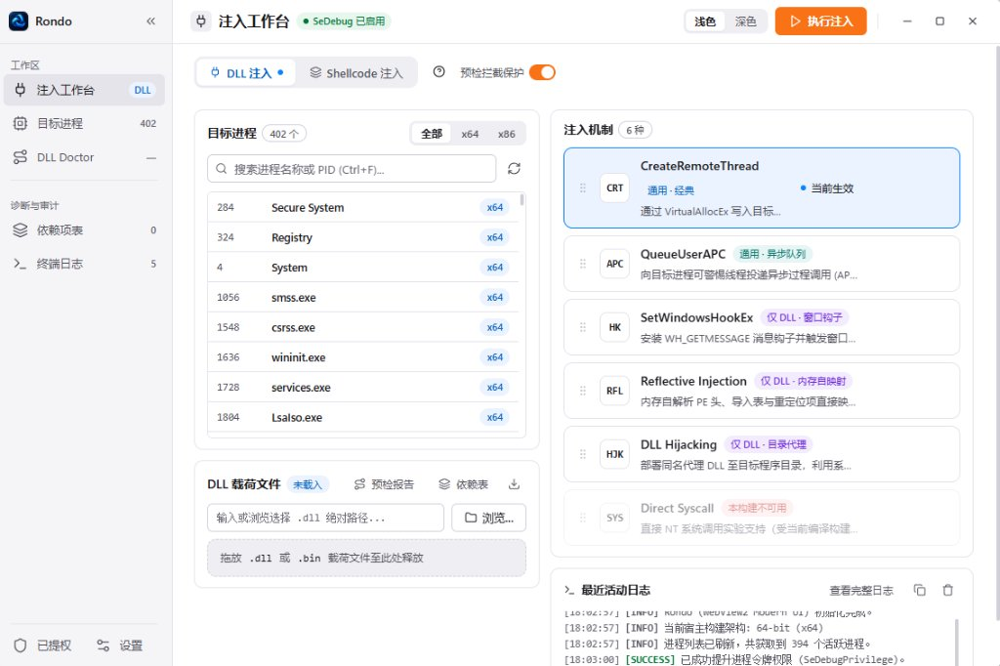

<p align="center">
  
</p>

<h1 align="center">Rondo</h1>

<p align="center">
  Windows DLL 注入与 PE 诊断工具集
</p>

<p align="center">
  <a href="https://github.com/som1ng/Rondo/releases/tag/v2.0.0"></a>
  <a href="https://www.npmjs.com/package/@s0m1ng/rondo"></a>
  <a href="LICENSE"></a>
  
</p>

<br />

<p align="center">
  
</p>

<br />

## 功能

- **6 种注入方式** — CreateRemoteThread / QueueUserAPC / SetWindowsHookEx / Reflective Injection / DLL Hijacking / Direct Syscall
- **WebView2 现代 GUI** — 原生 Win32 + 嵌入式 WebView2，浅色/深色主题，支持进程筛选、架构过滤、DLL 拖放和实时日志
- **进程与模块查询** — 只读枚举系统进程及模块，支持 x64/x86 架构区分
- **PE 静态分析** — 解析 PE32/PE32+ 头部、节表、导入/导出/延迟导入，名称/序号/转发均可报告
- **DLL Doctor** — 诊断 PE 损坏、架构不匹配、依赖候选缺失，输出含证据和置信度
- **多格式报告** — JSON / Markdown / HTML 单文件离线报告，支持已保存报告二次转换
- **CLI 工具链** — 独立命令行，可脚本化、可管道，退出码语义明确
- **Agent / MCP 集成** — 提供 Agent Skill 和本地 stdio MCP 服务，支持 Codex / Claude Code / OpenCode / Pi

## 快速开始

### GUI

从 [Releases](https://github.com/som1ng/Rondo/releases/tag/v2.0.0) 下载对应架构的压缩包，解压后运行 `Rondo.exe`。

| 架构 | 下载 |
| --- | --- |
| Windows x64 | [rondo-gui-2.0.0-windows-x64.zip](https://github.com/som1ng/Rondo/releases/download/v2.0.0/rondo-gui-2.0.0-windows-x64.zip) |
| Windows x86 | [rondo-gui-2.0.0-windows-x86.zip](https://github.com/som1ng/Rondo/releases/download/v2.0.0/rondo-gui-2.0.0-windows-x86.zip) |

> 依赖 [WebView2 Runtime](https://developer.microsoft.com/en-us/microsoft-edge/webview2/) 和 [VC++ v14 运行库](https://learn.microsoft.com/en-us/cpp/windows/latest-supported-vc-redist)。

### npm

```powershell
npm install -g @s0m1ng/rondo
rondo self-check
rondo --version --json
```

> 需要 Windows x86/x64、Node.js 22.19+ 和 VC++ v14 运行库。详见 [npm 包说明](integrations/npm/README.md)。

### 从源码构建

```powershell
git clone https://github.com/som1ng/Rondo.git
cd Rondo
python -m pip install -r tests/requirements.txt   # 测试依赖
cmake --preset msvc-x64
cmake --build --preset msvc-x64-debug --parallel
ctest --preset msvc-x64-debug
```

> 需要 Visual Studio 2022 C++ 工具、CMake 3.21+、Windows SDK。测试另需 Python 3.9+。

构建产物：
- GUI: `build/msvc-x64/Debug/Rondo.exe`
- CLI: `build/msvc-x64/Debug/cli/rondo.exe`

## CLI 用法

```powershell
rondo process list --json                                           # 枚举进程
rondo process inspect --pid <PID> --json                            # 查询进程详情
rondo process modules --pid <PID> --json                            # 列出模块
rondo pe inspect <file.dll> --json                                  # PE 静态解析
rondo doctor <file.dll> --target-arch x64 --json                    # DLL 诊断
rondo doctor <file.dll> --search-dir ./libs --json                  # 依赖候选检查
rondo doctor <file.dll> --format html --output report.html          # 生成 HTML 报告
rondo report export saved.json --format html --output out.html      # 已保存报告转换
```

退出码：`0` 正常 / `1` 阻断发现 / `2` 参数错误 / `3` 目标不可访问 / `4` 内部错误 / `5` 超时

## Agent 集成

Rondo 提供 [Agent Skill](integrations/skills/windows-dll-doctor/SKILL.md) 和 [MCP 服务](integrations/mcp/README.md) 用于 AI 辅助诊断。

```powershell
# 一键安装到支持的 Agent 客户端
rondo setup --agent auto --scope project --verify
```

支持的客户端：Codex、Claude Code、OpenCode、Pi。详见 [Agent 接入说明](docs/AGENT_COMPATIBILITY.md) 和 [安装器文档](integrations/installer/README.md)。

## 项目结构

```text
src/                    Win32 GUI 与方法实现
include/dllinjector/    进程/PE 类型与公共接口
core/                   进程查询、PE 解析、RAII 工具
apps/cli/               命令行入口与输出格式化
schemas/                版本化 JSON Schema
tests/                  Win32 回归测试与 fixture
integrations/           Agent Skill / MCP / npm / 安装器
docs/                   契约文档与验证记录
```

## 文档

| 文档 | 说明 |
| --- | --- |
| [CLI 契约](docs/P1_CONTRACT.md) | 命令行接口规范 |
| [PE 解析契约](docs/PE_TABLES_CONTRACT.md) | PE 静态检查细节 |
| [Doctor 契约](docs/DOCTOR_CONTRACT.md) | 诊断逻辑与字段说明 |
| [依赖候选契约](docs/DEPENDENCIES_CONTRACT.md) | 搜索目录候选检查 |
| [报告契约](docs/REPORTS_CONTRACT.md) | Markdown / HTML 报告 |
| [离线转换契约](docs/SAVED_REPORTS_CONTRACT.md) | 已保存报告再导出 |
| [模块契约](docs/MODULES_CONTRACT.md) | 模块枚举与字段 |
| [Agent 接入](docs/AGENT_COMPATIBILITY.md) | Skill / MCP 安装与验证 |
| [npm 包说明](integrations/npm/README.md) | 全局安装与 self-check |
| [路线图](docs/ROADMAP_STATUS.md) | 阶段状态与计划 |

## English

Rondo 2.0 is a Windows DLL injection and PE diagnostic toolkit. It ships a WebView2 GUI, a standalone CLI, an npm package (`@s0m1ng/rondo`), and Agent Skill / MCP integrations.

Download the GUI from [Releases](https://github.com/som1ng/Rondo/releases/tag/v2.0.0), or install via npm:

```powershell
npm install -g @s0m1ng/rondo
rondo self-check
```

See the sections above for build instructions and CLI usage.

## 许可证

项目自有代码采用 [MIT](LICENSE) 许可。第三方代码保留各自许可，详见 [THIRD_PARTY_NOTICES](docs/THIRD_PARTY_NOTICES.md)。

---

<p align="center">
  <a href="https://github.com/som1ng/Rondo/issues">Issues</a> · <a href="https://github.com/som1ng/Rondo/releases">Releases</a>
</p>
